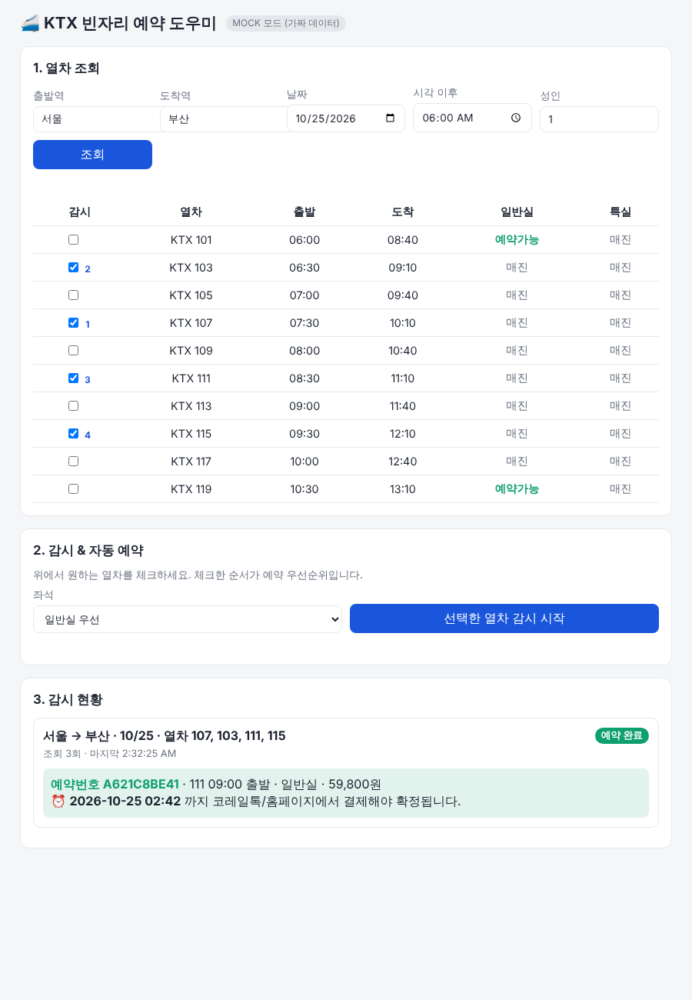

# 🚄 KTX 빈자리 예약 도우미 (개발 초안)

매진된 KTX 열차를 일정 주기로 다시 조회하다가 **빈자리가 생기면 바로 예약(좌석 홀드)** 하고 알려주는 개인용 웹앱입니다.
결제는 자동으로 하지 않습니다. 예약 후 **결제 기한(보통 10~20분) 안에 코레일톡/홈페이지에서 직접 결제**해야 확정됩니다.



## 빠른 시작

```bash
python3 -m venv .venv && source .venv/bin/activate
pip install -r requirements.txt
cp .env.example .env          # 기본값 PROVIDER=mock (가짜 데이터)
uvicorn app.main:app --reload
# → http://localhost:8000
pytest -q                     # 단위 테스트
```

## 동작 흐름

```
[웹 UI] ──조회──▶ POST /api/search ──▶ Provider.search()
   │  열차 체크(우선순위) + 좌석 옵션
   └──감시 시작──▶ POST /api/watches ──▶ WatchManager가 asyncio Task 생성
                                            │
              ┌─────────────────────────────┘
              ▼  (20초 ± 20% 지터, 오류 시 지수 백오프)
        Provider.search() → 지정 열차 중 조건 맞는 자리 있음?
              │ 아니오 → 대기 후 반복
              ▼ 예 (우선순위 순)
        Provider.reserve() ── 매진(SoldOut)이면 다음 후보 열차 시도
              ▼ 성공
        status=reserved → 텔레그램 알림 + 브라우저 알림(UI 3초 폴링)
```

## 구조

```
app/
  main.py            FastAPI 라우트 (/api/*) + 정적 파일 서빙
  config.py          환경변수 설정 (.env)
  models.py          Pydantic 모델 (TrainInfo, Watch, ReservationInfo ...)
  watcher.py         감시/자동예약 루프 (핵심 로직)
  notifier.py        텔레그램 알림
  providers/
    base.py          TrainProvider 인터페이스 + 예외
    mock.py          개발용 가짜 데이터 (자리 날 확률 15%, 예약 직전 매진 20%)
    korail.py        실제 코레일 연동 (korail2 래핑)
static/              바닐라 JS 프론트엔드 (빌드 불필요)
tests/               WatchManager 단위 테스트
```

## API

| Method | Path | 설명 |
|---|---|---|
| GET | `/api/health` | 상태 / provider 종류 |
| GET | `/api/stations` | 역 목록 |
| POST | `/api/search?adults=1` | 열차 조회 `{dep, arr, date:"YYYYMMDD", time:"HHMMSS"}` |
| GET | `/api/watches` | 감시 목록 |
| POST | `/api/watches` | 감시 시작 `{dep, arr, date, train_nos[], search_time, seat_option, passengers}` |
| DELETE | `/api/watches/{id}` | 감시 중지 |

`APP_TOKEN`을 설정하면 모든 API에 `X-App-Token` 헤더가 필요합니다. 내 코레일 계정으로 예약이 걸리는 앱이므로 외부에 띄울 땐 꼭 설정하세요.

## 실제 코레일 연동 (PROVIDER=korail)

```bash
pip install korail2 pycryptodome
# .env: PROVIDER=korail, KORAIL_ID, KORAIL_PW
```

- 코레일은 공식 공개 API가 없어 **모바일 앱의 비공식 API**를 사용합니다. 코레일 쪽 변경으로 언제든 깨질 수 있습니다.
- PyPI `korail2` 0.4.0은 오래되어 로그인이 안 될 수 있습니다. 그럴 땐 최근 유지보수되는 구현(예: SRTgo의 ktx 모듈)을 참고해 `app/providers/korail.py`만 교체하면 됩니다. 나머지 코드는 `TrainProvider` 인터페이스에만 의존합니다.
- **실계정으로 쓰기 전에 반드시 직접 검증하세요.** 이 초안은 mock으로만 테스트했습니다.

## 책임 있는 사용 (설계에 반영된 제한)

- 조회 주기 **최소 10초** 강제, 기본 20초 + 지터. 동시 감시 **최대 3개**. 코레일 서버 부하를 줄이고 계정 차단을 피하기 위함입니다.
- 코레일 이용약관은 매크로/자동화 프로그램 사용을 제한하며, 위반 시 계정 이용이 제한될 수 있습니다. 승차권 **부정 판매(되팔이) 목적 사용은 법적 제재 대상**입니다. 본인 이동 목적의 개인 용도로만 사용하세요.
- 결제 자동화는 일부러 넣지 않았습니다 (카드정보 저장 위험 + 사용자 확인 단계 유지).

## 다음 단계 (TODO)

- [ ] **실제 연동 검증**: korail provider 로그인/조회/예약 실계정 테스트, 최신 API로 교체
- [ ] **영속화**: 감시 목록을 SQLite에 저장 → 서버 재시작 시 복구
- [ ] **만료 처리 정교화**: 감시 대상 열차가 모두 출발하면 즉시 종료 (지금은 날짜 기준)
- [ ] **알림 채널 추가**: 카카오톡 알림톡 / 웹 푸시(Service Worker)
- [ ] **예약 내역 화면**: 코레일 계정의 기존 예약 조회 및 취소 (`korail.reservations()`, `cancel()`)
- [ ] **실시간 갱신**: 폴링 → SSE/WebSocket
- [ ] **배포**: Dockerfile, 항상 켜진 서버(예: 소형 VPS)에서 실행 — PC가 꺼지면 감시도 멈춤
- [ ] SRT 지원 (provider 하나 추가로 확장 가능)
